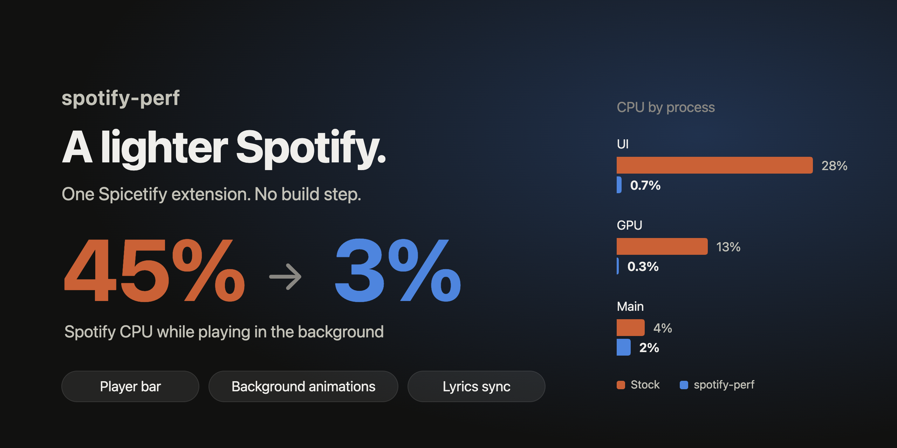
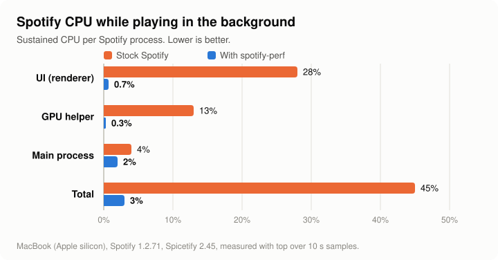
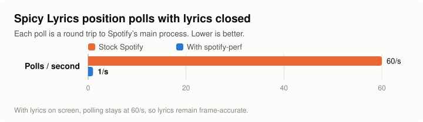

# spotify-perf



A [Spicetify](https://spicetify.app) extension that makes the Spotify desktop app use far less CPU, GPU and battery. One file, no build step.



## What it fixes

- **Player bar.** The progress bar repaints and re-lays out the whole app every second, even when Spotify is in the background. spotify-perf stops the animation and isolates the bar's layout.
- **Background animations.** UI animations pause while another app has focus, and resume when you come back. Audio is never touched.
- **Spicy Lyrics sync.** [Spicy Lyrics](https://github.com/Spikerko/spicy-lyrics) asks Spotify for the playback position 60 times a second, even with lyrics closed. spotify-perf drops that to once a second until lyrics are on screen. If Spicy Lyrics isn't installed, this does nothing.



Each fix can be turned off in the profile menu under **spotify-perf**.

## Install

```sh
curl -fsSL -o ~/.config/spicetify/Extensions/spotify-perf.js \
  https://raw.githubusercontent.com/alextyhwang/spotify-perf/main/spotify-perf.js
spicetify config extensions spotify-perf.js
spicetify apply
```

## Notes

- Tested on Spotify 1.2.71 with Spicetify 2.45. If a Spotify update renames the player bar, that fix stops applying and Spotify behaves as stock. Nothing breaks.
- To see what each fix is doing, run `SpotifyPerf.status()` in DevTools.
- Run the tests with `bun test`.

MIT License
